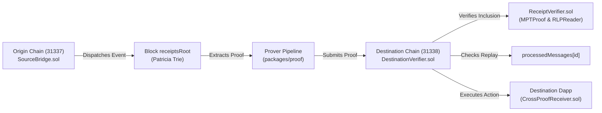

# CrossProof: Decentralized Cross-Chain Transaction Verification

> **Verify Across Chains. Trust the Proof.**

[](https://soliditylang.org/)
[](https://getfoundry.sh/)
[]()
[](LICENSE)

CrossProof is a modular cross-chain transaction verification protocol that enables smart contracts on a destination blockchain to verify cryptographic evidence about a transaction originating on another blockchain.

---

## The Core Problem

Independent blockchains maintain separate states, execution environments, consensus mechanisms, and transaction histories. Existing cross-chain bridges often introduce centralized multisigs, trusted relayer assertions, and critical points of failure.

### Core Principle
**Never accept a backend assertion that a transaction is valid when the required cryptographic inclusion and consensus evidence has not actually been verified on-chain.**

---

## Key Architecture & Features

- **Authentic Merkle Patricia Trie (MPT) Inclusion Verification:** Directly in Solidity, `MPTProof.sol` traverses trie branches and verifies that a transaction receipt belongs to the source block's `receiptsRoot`.
- **Domain-Separated Message Identification:** Binds source chain ID, source contract, destination chain ID, destination receiver, monotonic nonce, and payload hash to prevent collision and cross-chain replay.
- **On-Chain Replay Protection:** Enforced via persistent `mapping(bytes32 => bool) public processedMessages` following Checks-Effects-Interactions (CEI).
- **Modular Verifier Architecture:** Clean separation of concerns between Header Verification (`IHeaderVerifier`), Receipt Inclusion (`IReceiptVerifier`), and Application Execution (`IDestinationReceiver`).
- **Interactive Proof Attack Lab:** Live adversarial testing suite demonstrating that mutated proof nodes, replayed messages, and substituted payloads are strictly blocked on-chain.



---

## Project Structure

```
crossproof/
├── apps/
│   ├── api/             # Fastify + TypeScript backend API with Zod validation
│   └── web/             # React 18 + Vite + Tailwind CSS + Lucide frontend
├── contracts/
│   ├── src/
│   │   ├── interfaces/  # ISourceBridge, IDestinationVerifier, IReceiptVerifier, IHeaderVerifier
│   │   ├── libraries/   # MPTProof.sol (Trie verification), RLPReader.sol (RLP parser)
│   │   ├── receivers/   # CrossProofReceiver.sol (Application-level consumer)
│   │   ├── verifiers/   # ReceiptVerifier.sol, DevHeaderOracle.sol, LightClientHeaderVerifier.sol
│   │   ├── DestinationVerifier.sol
│   │   └── SourceBridge.sol
│   ├── test/            # 39 Comprehensive Foundry tests (unit, fuzz, attack simulations)
│   └── script/          # DeployCrossProof.s.sol
├── packages/
│   ├── proof/           # TypeScript MPT Patricia Trie builder & RLP encoder
│   └── shared/          # Shared TypeScript types, ABIs, chain configs
├── scripts/
│   ├── demo.js          # Automated end-to-end multi-chain demo runner
│   ├── deploy-local.ts  # Contract deployer for dual EVM chains
│   └── e2e-demo.ts      # Comprehensive verification and attack test script
├── docs/
│   ├── ARCHITECTURE.md  # Detailed technical design & sequence diagrams
│   ├── SECURITY.md      # Threat model, attacker capabilities & trust boundaries
│   ├── PROTOCOL.md      # Message layout, ID derivation & MPT specifications
│   ├── DEMO.md          # 3-5 minute judging demonstration script
│   └── KNOWN_LIMITATIONS.md # Implemented features vs production roadmap
├── .env.example
└── README.md
```

---

## Quickstart & Commands

### 1. Run the Automated End-to-End Demo
Executes the full pipeline: spawns dual local chains, deploys contracts, generates a real transaction, constructs the Patricia Trie proof, verifies it on the destination verifier, and demonstrates rejection of 3 adversarial attacks:

```bash
npm run demo
```

### 2. Run Smart Contract Test Suite
Executes all 39 Foundry security tests:

```bash
cd contracts
forge test -vv
```

### 3. Start Backend & Frontend Applications

```bash
# Terminal 1: Start Backend API (Port 3001)
npm run api:dev

# Terminal 2: Start Web Frontend (Port 5173)
npm run web:dev
```

Open `http://localhost:5173` in your browser.

---

## Honest Trust Model Disclosure

| Mode | Target | Trust Assumption | Verification Mechanics |
| :--- | :--- | :--- | :--- |
| **MODE A (Local Demo)** | Local Dev / Demo | Authorized relayer commits header to `DevHeaderOracle`. | Receipt inclusion under `receiptsRoot` is strictly verified cryptographically. Labeled clearly as development-only. |
| **MODE B (Consensus)** | Production | Consensus committee signatures or light client checkpoint. | Implemented in `LightClientHeaderVerifier.sol`: parses header RLP, verifies `blockHash == keccak256(headerRlp)`, extracts `receiptsRoot`, verifies committee signatures. |

---

## Security Invariants Enforced

1. **Replay Invariant:** A message ID can never be processed twice (`processedMessages[messageId]` persists on-chain).
2. **Inclusion Invariant:** A modified proof node or tampered receipt never succeeds (`keccak256` hash collision resistance).
3. **Domain Invariant:** A proof generated for destination chain $X$ is rejected on chain $Y$.
4. **Binding Invariant:** Substituted payload bytes cause immediate `PayloadHashMismatch` revert.
5. **Least Privilege:** Verification execution is permissionless; administrative functions are strictly restricted.

---

## License

MIT &copy; 2026 CrossProof Protocol Authors
