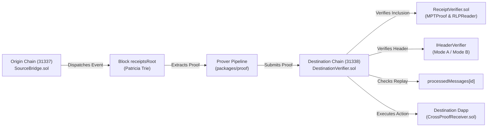

# CrossProof: Decentralized Cross-Chain Transaction Verification

> **Verify Across Chains. Trust the Proof.**

[](https://soliditylang.org/)
[](https://getfoundry.sh/)
[]()
[](LICENSE)

CrossProof is a modular cross-chain transaction verification protocol that enables smart contracts on a destination blockchain to verify cryptographic evidence about a transaction originating on another blockchain.

---

## The Core Problem

Independent blockchains maintain separate states, execution environments, consensus mechanisms, and transaction histories. Existing cross-chain bridges often introduce centralized multisigs, trusted relayer assertions, and critical points of failure.

### Core Principle
**Never accept a backend assertion that a transaction is valid when the required cryptographic inclusion and consensus evidence has not actually been verified on-chain.**

---

## Key Architecture & Features

- **Authentic Merkle Patricia Trie (MPT) Inclusion Verification:** Directly in Solidity, `MPTProof.sol` traverses trie branches and verifies that a transaction receipt belongs to the source block's `receiptsRoot`.
- **Decoupled Consensus Header Verification:** Explicit distinction between development oracle commitments (Mode A) and transition consensus attestation verification (Mode B).
- **Domain-Separated Message Identification:** Binds source chain ID, source contract, destination chain ID, destination receiver, monotonic nonce, and payload hash to prevent collision and cross-chain replay.
- **On-Chain Replay Protection:** Enforced via persistent `mapping(bytes32 => bool) public processedMessages` following Checks-Effects-Interactions (CEI).
- **Interactive Proof Attack Lab:** Live adversarial testing suite covering 10 distinct exploit vectors with strict failure semantics (`BLOCKED`, `VULNERABILITY_DETECTED`, `ERROR`, `INCONCLUSIVE`).
- **Zero Fake Verifications:** Real Patricia Trie root comparisons, memory-safe RLP encoding/decoding, and fail-closed error handling.



---

## Project Structure

```
crossproof/
├── apps/
│   ├── api/             # Fastify + TypeScript backend API with Zod validation
│   └── web/             # React 18 + Vite + Tailwind CSS + Lucide frontend
├── contracts/
│   ├── src/
│   │   ├── interfaces/  # ISourceBridge, IDestinationVerifier, IReceiptVerifier, IHeaderVerifier
│   │   ├── libraries/   # MPTProof.sol (Trie verification), RLPReader.sol (RLP parser)
│   │   ├── receivers/   # CrossProofReceiver.sol (Application-level consumer)
│   │   ├── verifiers/   # ReceiptVerifier.sol, DevHeaderOracle.sol, LightClientHeaderVerifier.sol
│   │   ├── DestinationVerifier.sol
│   │   └── SourceBridge.sol
│   ├── test/            # 42 Comprehensive Foundry tests (unit, fuzz, attack simulations)
│   └── script/          # DeployCrossProof.s.sol
├── packages/
│   ├── proof/           # TypeScript MPT Patricia Trie builder & RLP encoder (9 unit tests)
│   └── shared/          # Shared TypeScript types, ABIs, chain configs
├── scripts/
│   ├── demo.js          # Portable multi-chain demo runner (dynamic binary resolution)
│   ├── deploy-local.ts  # Contract deployer for dual EVM chains
│   ├── e2e-demo.ts      # Comprehensive verification and attack test script
│   └── resolveBinaries.js # Cross-platform Foundry resolution (PATH with workspace fallback)
├── docs/
│   ├── ARCHITECTURE.md  # Detailed technical design & sequence diagrams
│   ├── SECURITY.md      # Threat model, attacker capabilities & trust boundaries
│   ├── PROTOCOL.md      # Message layout, ID derivation & MPT specifications
│   ├── DEMO.md          # 3-5 minute judging demonstration script
│   └── KNOWN_LIMITATIONS.md # Implemented features vs production roadmap
├── .env.example
└── README.md
```

---

## Quickstart & Commands

### 1. Run the Full Stack Application
Starts dual local Anvil blockchains (Chain 31337 on port 8545, Chain 31338 on port 8546), deploys all protocol contracts, starts Fastify API (port 3001), and launches Vite frontend (port 5173):

```bash
npm run serve
```

### 2. Run Automated End-to-End Cryptographic Demo
Generates a real cross-chain dispatch transaction, reconstructs the Patricia Trie proof, verifies it on the destination verifier, and demonstrates rejection of adversarial attacks:

```bash
npm run demo
```

### 3. Run Smart Contract Test Suite
Executes all 42 Foundry security tests across 5 test suites:

```bash
cd contracts
forge test -vv
```

### 4. Run TypeScript Test Suites
Executes unit tests for proof builder and API routes:

```bash
npm test --workspace=@crossproof/proof
npm test --workspace=@crossproof/api
```

---

## Honest Trust Model Disclosure

| Mode | Target | Trust Assumption | Verification Mechanics |
| :--- | :--- | :--- | :--- |
| **MODE A (Local Demo)** | Local Dev / Demo | Authorized relayer commits header to `DevHeaderOracle`. | Receipt inclusion under `receiptsRoot` is strictly verified cryptographically. Labeled clearly as development-only. |
| **MODE B (Transition Attestation)** | Testnet Prototype | Designated committee threshold checkpoint in `LightClientHeaderVerifier`. | Parses execution block header RLP, verifies `blockHash == keccak256(headerRlp)`, extracts `receiptsRoot`, checks checkpoint boundary, and authenticates signatures. |

---

## 10 Adversarial Exploit Vectors (Attack Lab)

1. **Tampered MPT Node:** Corrupts Patricia Trie node bytes; blocked by `InvalidReceiptProof()`.
2. **Message Replay:** Resubmits finalized messageId; blocked by `MessageAlreadyProcessed()`.
3. **Unconfigured Source Chain:** Replays proof from unknown chain ID; blocked by `SourceChainNotConfigured()`.
4. **Mismatched Destination Chain:** Submits proof intended for another network; blocked by `InvalidDestinationChainId()`.
5. **Payload Substitution:** Replaces calldata payload; blocked by `PayloadHashMismatch()`.
6. **Spoofed Bridge Emitter:** Emits event from unauthorized contract; blocked by `InvalidSourceContract()`.
7. **Unfinalized Header:** References uncommitted block hash; blocked by `SourceHeaderVerificationFailed()`.
8. **Malformed Non-RLP Bytes:** Tests parser memory safety; blocked fail-closed by RLPReader.
9. **Unauthorized Admin Call:** Attempts to hijack verifier; blocked by `Unauthorized()` / `ZeroAddress()`.
10. **RPC Provider Failure:** Evaluates network timeout; strictly reports `outcome: ERROR` rather than false success.

---

## License

MIT &copy; 2026 CrossProof Protocol Authors
