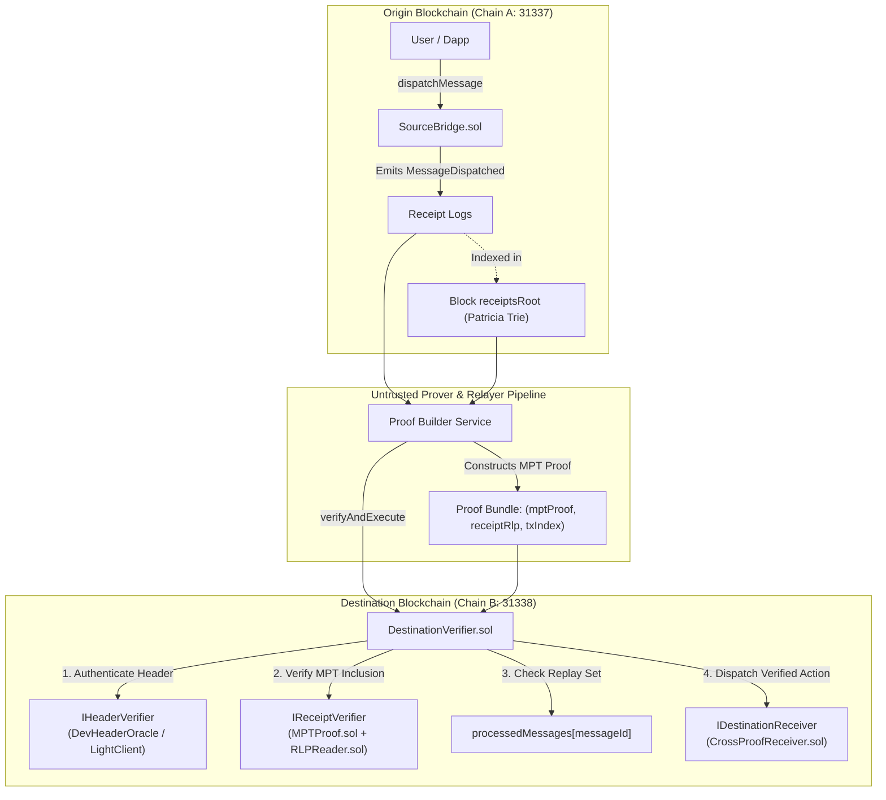

# CrossProof Protocol Architecture

> **Verify Across Chains. Trust the Proof.**

CrossProof is a decentralized, modular cross-chain transaction verification protocol that enables smart contracts on a destination blockchain to cryptographically verify transactions originating on another blockchain without blind trust in relayers, centralized oracles, or modified consensus rules.

---

## 1. Core Principle

**Never accept a backend or relayer assertion that a cross-chain event is valid when the required cryptographic inclusion and consensus evidence has not been independently verified by the destination smart contract.**

---

## 2. End-to-End System Architecture



---

## 3. Cryptographic Verification Pipeline

The protocol executes in seven deterministic stages:

### Stage 1: Source Message Dispatch
1. A user or contract calls `SourceBridge.dispatchMessage(destinationChainId, destinationReceiver, payload)`.
2. The contract generates a strictly increasing `nonce = ++nonceCounter`.
3. It derives a domain-separated unique `messageId`:
   $$\text{messageId} = \text{keccak256}(\text{abi.encode}(\text{MESSAGE\_TYPEHASH}, \text{sourceChainId}, \text{sourceContract}, \text{destinationChainId}, \text{destinationReceiver}, \text{nonce}, \text{keccak256}(\text{payload})))$$
4. Emits `MessageDispatched(messageId, sourceChainId, destinationChainId, sourceContract, destinationReceiver, nonce, payload, payloadHash)`.

### Stage 2: Source Block Receipt Merkle Patricia Trie
In EVM networks, transactions executed in a block produce receipts that are indexed into a Merkle Patricia Trie.
- Key: $k = \text{RLP}(\text{txIndex})$
- Value: $v = \text{RLP}([status, cumulativeGasUsed, logsBloom, logs])$ (prefixed with $0x02$ or $0x01$ for EIP-2718 typed transactions).
- Root: $\text{receiptsRoot}$ committed directly in the source block header.

### Stage 3: Proof Generation
The off-chain proof builder:
1. Queries the source RPC for block receipts using `eth_getTransactionReceipt`.
2. Reconstructs the exact Patricia Trie in memory using `@ethereumjs/trie`.
3. Validates that `trie.root() == block.receiptsRoot`.
4. Extracts the cryptographic branch and leaf nodes from root to the target receipt key: `trie.createProof(RLP(txIndex))`.

### Stage 4: Header Commitment & Finality
Before receipt inclusion can be accepted, the destination blockchain must establish that the source block hash and its `receiptsRoot` are authentic and finalized:
- **Mode A (Local Dev Header Oracle):** Authorized relayer commits $(chainId, blockNumber, blockHash, receiptsRoot)$ to `DevHeaderOracle.sol`.
- **Mode B (Light Client Consensus Verifier):** `LightClientHeaderVerifier.sol` validates RLP header decoding, computes `keccak256(headerRlp) == blockHash`, extracts `receiptsRoot` from header index 5, and validates consensus committee signatures against a trusted checkpoint.

### Stage 5: On-Chain MPT Receipt Inclusion Verification
`ReceiptVerifier.sol` invokes `MPTProof.sol`:
1. Checks that the first proof node hashes to the header's $\text{receiptsRoot}$:
   $$\text{keccak256}(\text{proof}[0]) == \text{receiptsRoot}$$
2. Traverses each branch and extension node, matching key nibbles derived from $\text{RLP}(\text{txIndex})$.
3. Confirms the leaf node contains the exact `receiptRlp`.
4. Decodes the receipt using `RLPReader.sol`:
   - Enforces `status == 1` (rejects reverted transactions).
   - Locates log where `emitter == expectedSourceBridge` and `topics[0] == MessageDispatched`.
   - Validates `keccak256(payload) == payloadHash`.
   - Recomputes `messageId` and confirms exact match.

### Stage 6: On-Chain Replay Protection
`DestinationVerifier.sol` implements Checks-Effects-Interactions (CEI):
```solidity
if (processedMessages[messageId]) {
    revert MessageAlreadyProcessed(messageId);
}
processedMessages[messageId] = true;
```
This is stored in persistent smart contract state and cannot be bypassed by frontend reloads or backend database manipulation.

### Stage 7: Destination Application Execution
If the `destinationReceiver` is a contract, `DestinationVerifier` calls:
```solidity
IDestinationReceiver(receiver).onCrossChainMessage(messageId, sourceChainId, sourceContract, payload);
```
Ensuring the application only acts upon fully authenticated cross-chain messages.

---

## 4. Smart Contract Hierarchy & Responsibilities

| Contract | Interface | Role |
| :--- | :--- | :--- |
| **`SourceBridge.sol`** | `ISourceBridge` | Origin contract. Dispatches messages, computes domain-separated IDs, enforces nonce ordering. |
| **`DestinationVerifier.sol`** | `IDestinationVerifier` | Core verification router on destination chain. Coordinates header and receipt verifiers, enforces replay protection. |
| **`ReceiptVerifier.sol`** | `IReceiptVerifier` | Cryptographic engine for Patricia Trie receipt proof verification and RLP log extraction. |
| **`DevHeaderOracle.sol`** | `IHeaderVerifier` | Development mode header oracle for deterministic local testing (Mode A). |
| **`LightClientHeaderVerifier.sol`** | `IHeaderVerifier` | Consensus-proof verifier parsing header RLP, extracting receiptsRoot, and validating committee signatures (Mode B). |
| **`CrossProofReceiver.sol`** | `IDestinationReceiver` | Destination application receiving verified calls. |
| **`MPTProof.sol`** | N/A (Library) | Ethereum Patricia Merkle Trie traversal and leaf verification library. |
| **`RLPReader.sol`** | N/A (Library) | Memory-safe RLP decoding library for Ethereum receipts and log items. |

---

## 5. Technology Stack Summary

- **Smart Contracts:** Solidity `^0.8.20`, Foundry (`forge`, `anvil`), via-IR optimizer enabled.
- **Backend API:** Fastify, TypeScript, Viem, Zod validation schemas.
- **Proof Pipeline:** `@ethereumjs/trie`, `@ethereumjs/rlp`, Viem.
- **Frontend App:** React 18, Vite, TypeScript, Tailwind CSS, Lucide icons.
